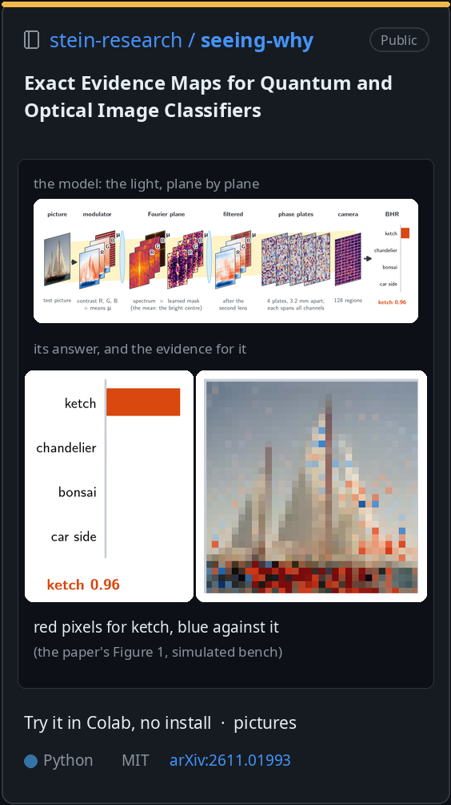
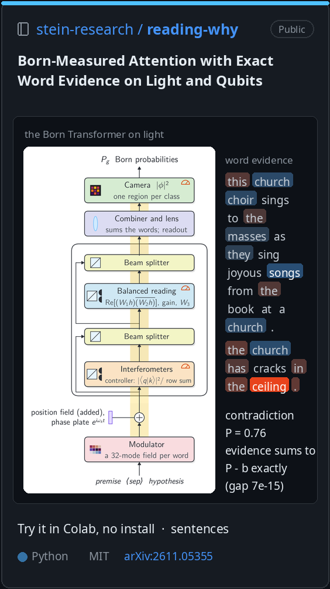
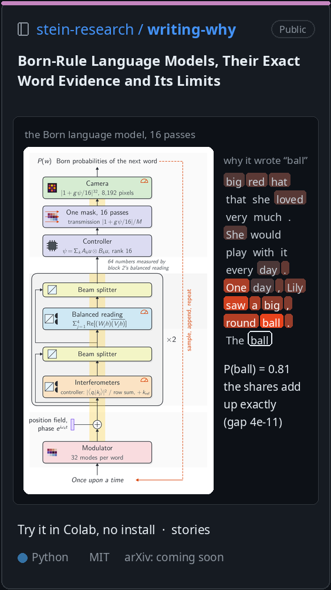

## Born-rule models whose evidence is exact by construction

Three papers, one idea: read the measurement of a quantum circuit or an optical system with a readout shaped by the
Born rule, and the evidence of every input — each pixel, each word — has a closed form that adds up exactly to how far
the answer's probability rises above its share, and it can be measured on the hardware itself. Each paper runs its
model on simulated light and measures it, or part of it, on IBM quantum processors.

| | what the model does | paper | try it (no install) |
|---|---|---|---|
| **[Seeing Why](https://github.com/stein-research/seeing-why)** | classifies pictures and shows which pixels decided it | [arXiv:2611.01993](https://arxiv.org/abs/2611.01993) |  |
| **[Reading Why](https://github.com/stein-research/reading-why)** | a Born Transformer that reads two sentences and shows which words decided the answer | [arXiv:2611.05355](https://arxiv.org/abs/2611.05355) |  |
| **[Writing Why](https://github.com/stein-research/writing-why)** | a Born language model that writes stories and shows why it chose each word | arXiv: coming soon |  |

**Where to start:** Seeing Why if you like to see it in a picture; Reading Why for the transformer; Writing Why for a
model that writes. Each repository holds the paper's code, data, results and IBM job records, so every number in the
papers can be checked again.

Teerawat Tongloy (KMITL), Jiraporn Pongsopa and Rangsan Jomtarak (Suan Dusit University). MIT licence.

**Contact:** Teerawat Tongloy, School of Integrated Innovative Technology, KMITL, Bangkok —
[teerawat.to@kmitl.ac.th](mailto:teerawat.to@kmitl.ac.th)
